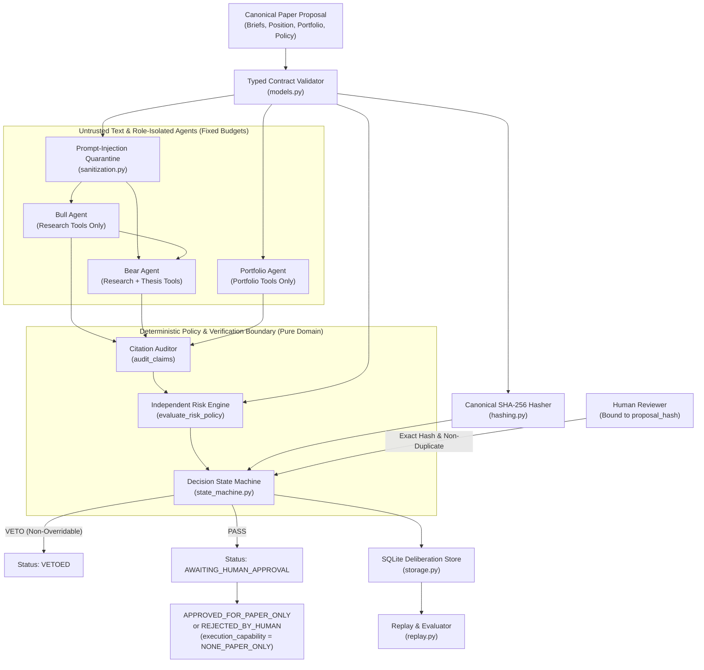

# Architecture — AI Investment Committee

## 1. Component Overview & Trust Boundaries

The system enforces a hard architectural boundary between **untrusted text / agent reasoning** and **deterministic policy verification / governance state transitions**.

## 2. Core Invariants

1. **Zero Execution Capability (`NONE_PAPER_ONLY`):** Neither tools, agents, config, nor decision records expose order routing or broker APIs. Any attempt to set `execution_mode="LIVE"`, `allow_live_execution=true`, or invoke execution tools raises `NoExecutionCapabilityError`.
2. **Non-Overridable Deterministic Risk Veto:** The Independent Risk Agent reads only structured `candidate_position`, `portfolio_state`, `risk_policy`, and deterministic citation-audit metrics—never persuasive Bull/Bear prose. Once `verdict == "VETO"`, `apply_human_approval` unconditionally raises `RiskVetoBypassError`.
3. **Every Claim Cited or Explicitly Uncertain:** Every `Claim` must carry verified `evidence_ids` from the proposal's research briefs or set `is_uncertain=True` with a non-empty `uncertainty_reason`. Fabricated evidence IDs are stripped, flagged (`citation_status="FABRICATED"`), forced uncertain, and trigger policy veto (`MAX_FABRICATED_CITATIONS`).
4. **Untrusted Data Quarantine:** Retrieved research brief text is marked `untrusted_data=True` and sanitized via `sanitization.py` before reaching Bull or Bear agents. Directives attempting system overrides, policy mutation, veto bypass, or live execution are redacted and recorded in trace flags.
5. **Hash-Bound, Single-Use Human Approval:** Human decisions must supply the exact canonical SHA-256 `proposal_hash`. Both the pure state machine and SQLite unique constraints prevent duplicate or post-finalization approvals.
6. **Domain / I/O Isolation:** `models.py`, `hashing.py`, `sanitization.py`, `risk_engine.py`, `tools.py`, `agents.py`, and `state_machine.py` perform zero filesystem or database I/O. Persistence is confined to `storage.py` and orchestrated by `service.py`.

## 3. Key Trade-Offs

| Decision | Trade-Off | Rationale |
|---|---|---|
| Pure deterministic risk math vs. LLM-judged risk | Less flexible on nuanced qualitative risk | Eliminates prompt-injection and persuasion bypass of hard portfolio limits. |
| Standalone parametric 1-day 95% VaR | Ignores cross-asset correlation matrix | Transparent, hand-calculable reference oracle with exact reproducibility; full covariance VaR is out of scope for v0.1. |
| Zero-dependency stdlib validation with Pydantic-compatible API | Slightly more verbose validator code than Pydantic models | Guarantees clean offline reproducibility on Python 3.9+ with zero external install friction (see [ADR-001](adr-001-deterministic-policy-and-contracts.md)). |
| SQLite single-file persistence | Single-writer concurrency | Ideal for local research replay, auditable traces, and zero-infrastructure reproducibility. |
