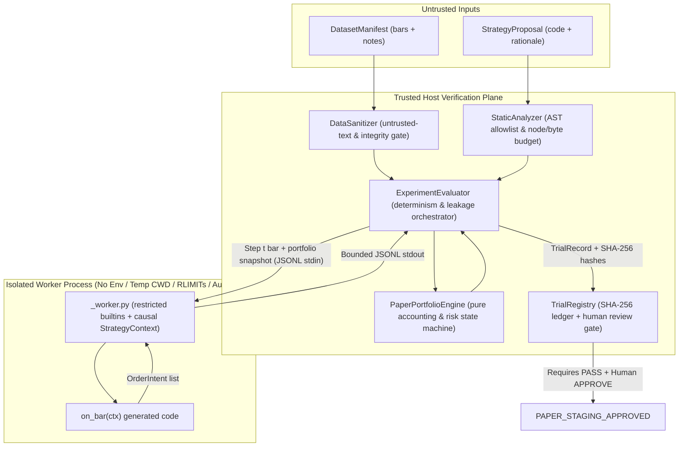

# Architecture — AI Strategy Code Generation Sandbox

## 1. System overview and trust boundaries

The sandbox separates untrusted inputs (LLM-generated strategy code, rationale text, and dataset metadata notes) from deterministic verification, paper accounting, and governance state.

## 2. Defense-in-depth isolation layers

1. **Gate 1 — Untrusted dataset screening (`data_sanitizer.py`)**: Scans `DatasetManifest.description` and all `AssetBar.note` strings for prompt-injection overrides, code-execution payloads, credential exfiltration directives, delimiter injections, and hidden Unicode control/bidi characters before any code runs.
2. **Gate 2 — Static AST policy (`static_analyzer.py`)**: Enforces code byte size, AST node count, explicit import allowlist (`math`, `statistics`), banned builtins (`open`, `eval`, `exec`, `compile`, `__import__`, `getattr`, etc.), banned dunder attribute traversal (`__class__`, `__subclasses__`, `__globals__`, etc.), and presence of `def on_bar(ctx):`.
3. **Gate 3 — Isolated subprocess worker (`sandbox_runner.py`, `_worker.py`)**:
   - Launched with `python -I -S` (isolated mode, no user site-packages), a freshly created empty temporary working directory, and a scrubbed environment containing zero host variables (no API keys, cloud tokens, or broker credentials).
   - Process-group isolation (`start_new_session=True`) with wall-clock watchdog (`SIGKILL` to entire process group on timeout).
   - OS limits: `RLIMIT_CPU`, `RLIMIT_NOFILE`, `RLIMIT_CORE=0`, and `RLIMIT_AS` (on Linux).
   - Python PEP 578 `sys.addaudithook` denying C-level `open`, `socket.*`, `os.*`, `subprocess.*`, `urllib.*`, `http.*`, `ctypes.*`, unauthorized `import`, and post-load `compile`/`exec`.
   - Worker-side AST dunder guard, monkey-patched network/filesystem/process APIs, strictly allowlisted `__builtins__`, `tracemalloc` memory budget enforcement, and host-side bounded stdout reading (`max_output_bytes`).
4. **Gate 4 — Causal IPC boundary**: The host streams bar `t` and current portfolio state over stdin only after step `t - 1` completes. Future bars `t+1..T` never exist in worker memory during step `t`.
5. **Gate 5 — Optional rootless container layer (`Dockerfile`, `docker-compose.yml`, `DockerSandboxRunner`)**: Provides a hardened rootless container profile (`--network=none`, `--read-only`, `--cap-drop=ALL`, `--pids-limit`, `--memory`, `--cpus`) for environments with Docker/Podman installed.

## 3. Core invariants

- **Strict causality**: Decisions at step `t` cannot depend on bars `> t`, verified both structurally (step-by-step IPC) and empirically (future-shock perturbation + prefix-truncation invariance tests).
- **Determinism**: Identical `(config, spec, dataset, proposal, budget, seed)` inputs produce identical orders, fills, equity curve, `trial_id`, and `output_sha256`.
- **Double-entry paper accounting**: At every step `t`, `equity = cash + sum(qty_i * close_i)` and `|equity - (initial_cash + realized_pnl + unrealized_pnl - cumulative_commission)| <= 1e-6`.
- **Governance invariant**: No strategy proposal can be promoted to `PAPER_STAGING_APPROVED` without (a) hash-verified trial integrity, (b) `status == "PASSED"` with zero failed checks, and (c) a persisted `HumanReviewRecord` with `decision == "APPROVE"` bound to the exact `trial_id`, `code_sha256`, and `output_sha256`.

## 4. Key trade-offs and limitations

- **Subprocess vs. VM/microVM isolation**: Subprocess isolation plus PEP 578 audit hooks and `rlimit`s is fast (~30 ms per run) and portable across developer laptops, but is **not** a kernel-level security boundary against CPython zero-days or kernel exploits. Untrusted third-party code in multi-tenant environments requires OS virtualization (e.g., Firecracker/gVisor/Kata Containers) in addition to container hardening.
- **macOS `RLIMIT_AS` limitation**: On macOS ARM64, `RLIMIT_AS` virtual memory reservations conflict with the Python runtime, so memory limits on macOS rely on `tracemalloc` inside the worker; Linux environments (including CI) apply both `RLIMIT_AS` and `tracemalloc`.
- **Step-by-step IPC overhead**: Streaming one JSON line per bar adds ~1–2 ms for a 10-bar dataset while guaranteeing zero future bars exist in worker memory. For very high-frequency datasets (millions of bars), batched causal chunks would be required.
