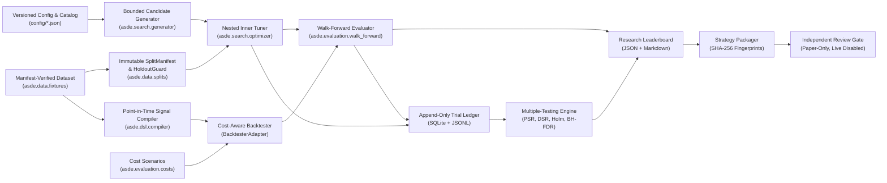

# Architecture — Autonomous Strategy Discovery Engine

## Component Boundaries

## Core Design Principles

1. **Constrained Search Space Only**: All strategies are declarative `StrategySpec` records validated against `config/strategy_catalog.json`. Any unconstrained code payload (`raw_code`, `eval`, `exec`, `python`, etc.) raises `UnconstrainedCodeError`.
2. **Strict Point-in-Time & Zero Look-Ahead**: Every `MarketBar` carries explicit UTC `event_time_utc` and `available_time_utc`. `SignalCompiler` verifies `available_time_utc` monotonicity and enforces `signal_lag_bars >= 1`.
3. **Immutable Chronological Splits & Holdout Guard**: `SplitManifest` partitions bars strictly chronologically into `train`, `validation`, and `test` with configurable `embargo_bars` gaps and a cryptographic `manifest_hash`. `HoldoutGuard` blocks any access to `test` indices prior to `lock_selection()` and records every access and blocked attempt.
4. **Honest Trial Accounting**: Every inner-tuning trial, outer walk-forward trial, baseline evaluation, rejection, and exception (`FAILED`) is persisted in `SqliteTrialStore` and exported to `trials.jsonl`. The full trial count `N` feeds into Deflated Sharpe Ratio (DSR), Bonferroni, Holm-Bonferroni, and Benjamini-Hochberg FDR.
5. **Clean Adapter Seams**: External engines (`BacktesterAdapter`, `OptimizerAdapter`, `TrialStore`) are isolated behind typed Python `Protocol` contracts so TS-06, TS-14, QT-09, Optuna, Polars, or PostgreSQL can be wired without changing domain logic.
6. **Fail-Safe Governance**: Discovery runs enforce `order_execution_enabled=false` and `allow_live_selection=false`. Exported packages default to `PENDING_INDEPENDENT_REVIEW` and `research_only`. Independent reviewers can approve at most `paper_sandbox`; live/real-capital targets are rejected by `ReviewGate`.
