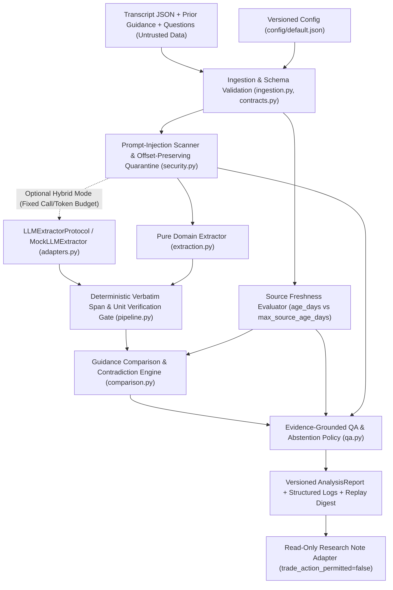

# Architecture — Earnings Call Intelligence Agent

## 1. High-Level Pipeline & Trust Boundaries

All incoming transcript text is treated as **untrusted data**. Model proposals (when `extraction_mode="hybrid"`) are likewise treated as untrusted until verified verbatim against the original non-quarantined segment text. Policy gates (freshness, abstention, no-trade enforcement, and fixed resource budgets) are strictly deterministic.

## 2. Module Responsibilities

| Module | Layer | Pure / I/O | Responsibility |
|---|---|---|---|
| `contracts.py` | Contracts | Pure (except `from_file`) | Typed dataclasses, enums, UTC timestamp parsing, unit & fiscal period normalization, verbatim `EvidenceSpan` builder, structured error hierarchy |
| `security.py` | Security | Pure | Detects 7 classes of prompt-injection patterns; masks offending sentences with equal-length spaces so surviving text preserves exact source offsets |
| `ingestion.py` | Boundary | Boundary | Validates `TranscriptInput`, computes `input_digest`, checks `max_segments` budget, computes `SourceFreshness`, invokes security quarantine |
| `extraction.py` | Domain | Pure | Extracts `REPORTED_METRIC` and `FORWARD_GUIDANCE` claims from executive segments with normalized units, fiscal periods, accounting basis, uncertainty cues, and verified evidence spans |
| `comparison.py` | Domain | Pure | Groups guidance claims by `(metric, period, basis, unit)`, detects intra-call contradictions, diffs against `PriorGuidanceRecord`s, assigns `GuidanceDirection` and uncertainty flags |
| `qa.py` | Policy | Pure | Answers questions strictly from verified claims; abstains with explicit `AbstentionReason` on stale sources, missing evidence, contradictions, or injection-only topics |
| `adapters.py` | Adapters | Boundary | `LLMExtractorProtocol`, `MockLLMExtractor`, budgeted verifier rejecting unverified/quarantined proposals, and read-only `export_research_note_envelope` |
| `pipeline.py` | Orchestrator | Pure | Connects stages, enforces final verbatim verification gate, computes deterministic `run_id` and logical replay digest, collects diagnostic counters and structured logs |
| `evaluation.py` | Evaluation | Boundary | Runs gold benchmark suites, computes Precision/Recall/F1, citation validity rate, guidance accuracy, abstention accuracy, and injection defense metrics |
| `cli.py` | Interface | I/O | CLI subcommands (`analyze`, `replay`, `evaluate`, `validate-config`) with explicit non-zero exit codes and JSON stderr errors |

## 3. Core Invariants

1. **Verbatim Evidence Invariant:** For every `ExtractedClaim` in `AnalysisReport.claims`, `0 <= char_start < char_end <= len(segment.text)` and `segment.text[char_start:char_end] == exact_quote` and `evidence.verified is True`.
2. **Normalized Units Invariant:** Every numerical claim is normalized to a `CanonicalUnit` (`USD_MILLIONS`, `USD_PER_SHARE`, `PERCENT`, `BPS`, `COUNT`, `RATIO`) before comparison or reporting.
3. **Abstain Without Support Invariant:** Questions lacking verified fresh evidence never produce fabricated answers; they return `answered=False, abstained=True` with a typed `AbstentionReason`.
4. **No Trade Execution Invariant:** `allow_trade_actions` is rejected by `AgentConfig` if set to `True`, and `trade_action_permitted` is hardcoded to `False` across all outputs and adapters.
5. **Deterministic Replay Invariant:** Identical versioned inputs, config, seed, and `as_of_timestamp` produce identical `run_id` and `report_logical_digest`.

## 4. Key Trade-Offs

- **Rule-based deterministic default vs. LLM extraction:** Deterministic extraction guarantees 100% offline reproducibility and zero hallucination risk, at the cost of narrower linguistic coverage than an LLM. Hybrid mode addresses broader phrasing while keeping the deterministic verification gate mandatory.
- **Sentence-level whitespace masking vs. dropping entire segments:** Masking offending sentences with equal-length spaces protects against injected fake numbers while preserving legitimate disclosures in the same speaker turn and keeping original character offsets valid.
- **Executive-only claim extraction:** Excluding `ANALYST` and `OPERATOR` turns from claim extraction prevents analyst hypotheticals or consensus estimates from polluting official company claims, while still running security scans across every segment.
