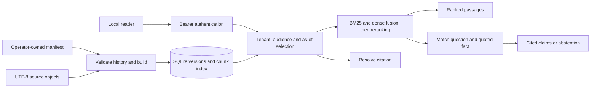

# Architecture and design decisions

### Corpus and time

A tenant owns document IDs. A logical document represents one issuer, fiscal period, kind and audience. A new version replaces the entire previous text. The event timestamp identifies the source event and the availability timestamp identifies when the operator could first have used the version. Eligible versions must pass both time checks. The most recently available eligible version wins even if a previous version would match the question better. Access uses the reader's current entitlements for historical queries. A deletion retires the entire ID across all times immediately upon manifest application.

### Storage decision

For the local corpus, one SQLite transaction builds the canonical version records and both search representations. Object paths live under the manifest directory. SHA-256 pins the original bytes. The builder checks the ordered fingerprints of already-applied events before replacing its projection. SQLite write-ahead logging serializes writers and lets readers use a consistent snapshot during a rebuild. Publishing and deletion share the same commit boundary. A fresh empty database must be seeded from the operator's current authoritative manifest. Code, config, manifest and source bytes together specify a rebuild.

### Ranking decision

Split nonempty source lines into passages capped at 480 Unicode code points by default. Prefer sentence endings and spaces when splitting a long line. Index raw token frequencies and a normalized dense vector. The local embedding adapter sums reproducible signed hash projections of terms with logarithmic term frequency. A small financial alias map brings terms such as sales and revenue into the same vector direction. It is a compact lexical embedding with limited synonym coverage.

Search computes BM25 (k1 = 1.2, b = 0.75) and cosine similarity against eligible chunks. Only positive channel scores enter weighted reciprocal rank fusion (rank constant 20). The reranker combines the fused score with query-term coverage, then breaks ties by chunk ID. Both corpus statistics and ranking use only the eligible set. Configuration fixes the dimension, candidate cap and channel weights. Cost grows linearly with visible chunks and their vector width. The local baseline uses a scan and in-process ranking.

### Answer decision

The reader service parses a narrow financial-question grammar and matches the issuer, fiscal year and metric against a complete standalone source line. Each claim is the exact source wording. The source's currency, scale, sign and precision are preserved. A comparison returns individually attributed values from at least two distinct documents. Its relation describes textual agreement of the reported amounts. Numeric conversions, reconciliations and issuer truth verification require further work. Retrieval can return relevant research even when the answer grammar abstains.

### Trust and dependency assumptions

The operator controls source selection, licensing, manifest chronology, issuer attribution and reader entitlements. Labels and hashes establish provenance inside that trust boundary. Text from a reader or document cannot invoke tools, change the principal or supply a new access predicate. An entitled source can still contain false statements, contradictory context or misleading figures. A citation establishes passage support only.

The Python modules separate manifest ingestion, local indexing, the reader service and HTTP authentication. A replacement embedding or reranking implementation belongs in the indexing layer and requires a full rebuild and evaluation. There are no network model calls, trading interfaces, downloaded weights, personal repository imports or shared services. Dependencies #4, #17 and #19 remain integration candidates pending ownership and interface review.

### Unsupported at this stage

PDF/OCR/table parsing, open-ended generative answers, natural-language arithmetic, cross-currency normalization, multilingual embeddings, learned reranking, distributed or approximate nearest-neighbor search, enterprise identity federation, streaming revocation of in-flight results, immutable audit infrastructure and production hosting are outside this local prototype. Filesystem access to the database is operator-level access. Readers on mutually untrusted machines require a separately reviewed deployment.
