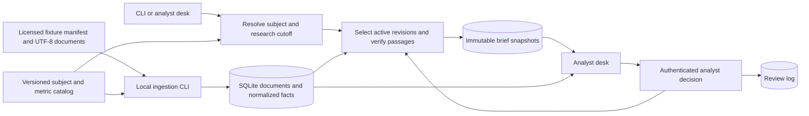

# Architecture and decisions

**Storage.** One SQLite transaction imports a manifest, including original bytes, immutable document metadata and derived facts. A failed import rolls back the batch. A unique series/revision pair and an explicit predecessor prevent revision forks. Full replacements may withdraw prior facts. Document IDs cannot be reused for different content. The database also holds immutable query snapshots, one terminal review per snapshot, and counters. Serializing writers prevents ingest/review races.

**Provider boundary.** A local manifest and adjacent files are the ingestion adapter. It reads hash-pinned bytes, checks the local entitlement label and validates document identity before indexing. A future provider adapter would need an approved entitlement policy and a source-specific parser that preserves original locators and availability times. No code or data from sibling projects was imported. The dependencies referenced as #17, #19 and #6 in the plan are integration candidates with unconfirmed ownership and interfaces.

**Research.** Issuer names, aliases, instrument identifiers and macro entities resolve through a fixed versioned catalog. Metric parsing uses exact decimals, a fixed unit per metric and reporting currency per issuer. The research engine selects the active version of every eligible series for a subject at the supplied cutoff. It rehashes the stored bytes, reparses facts and verifies them against the index before returning a passage or a claim.

**Decisions.** A v1 brief is a list of requested observations. A supported result has one agreed value, at least one fresh source and citations. An unavailable or unsupported answer abstains. An unresolved disagreement exposes both values and their evidence. A multi-measure brief may be partially supported. A reviewer can reject any pending brief. Approval reruns the original request inside the write transaction, verifies full support and checks equality with the snapshot before recording the configured analyst identity. Later ingestion leaves the historical decision attached to its original evidence.

**Deployment assumptions.** One trusted operator controls the corpus, schema, catalog, local filesystem and wall clock. The MVP runs on loopback with a single configured analyst identity. SQLite stores the raw bytes and the normalized representation together for atomic updates and offline reproduction. PostgreSQL, a separate object store, a paid model and distributed processes add no required capabilities for this corpus. Production use needs an explicit storage, authentication, retention and scale decision.
