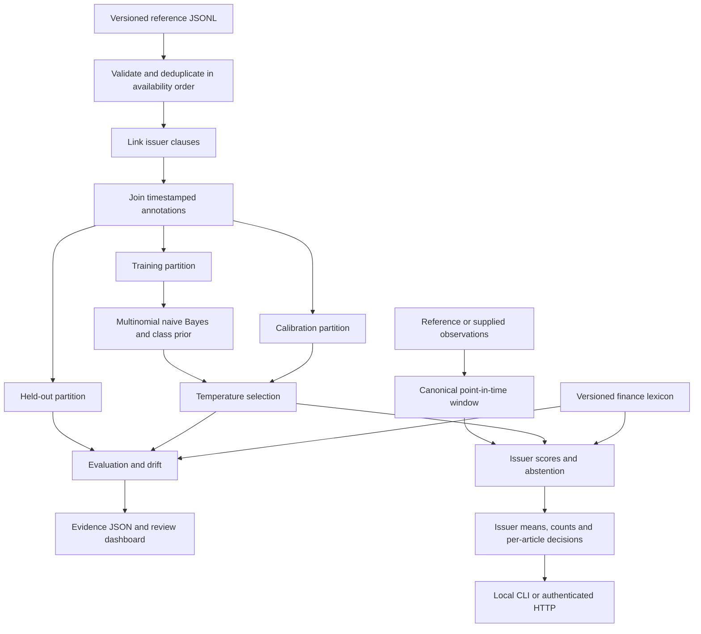

# Architecture and design decisions

### M1 · Contract and research assumptions

This greenfield slice uses fictional English-language company news. An article has one publication instant and one first-availability instant. An observation, its issuer annotation and the annotation's availability are separate records. The fixture manifest identifies both sources and hashes the inputs. The reference horizon is a 24-hour UTC event window, an implementation assumption for this demo. The strategy horizon, actual asset class, provider entitlements and SAAT ownership arrangements require owner confirmation before integration.

The engine loads a fixed snapshot into memory. External systems can export rows using the JSONL contract. There are no runtime dependencies on projects 18, 19 or 23. No assets or implementation were copied from personal repositories.

### M2 · Canonicalization and baselines

Normalize text with Unicode NFKC, case folding and whitespace collapse. SHA-256 of normalized headline and body identifies exact syndicated copies across sources. First availability wins, with immutable article ID as the tie-breaker. Identical replay is idempotent. Conflicting content or metadata for the same ID rejects the snapshot.

Match configured aliases at word boundaries, longest first. Split sentences and selected conjunctions into clauses. Strip aliases before classification. A sole unambiguous issuer can inherit unscoped text. With multiple issuers, only explicitly attributed clauses contribute. An ambiguous alias generates a linking issue. A shared clause with several identified companies causes an abstention for those mentions.

The non-text baseline predicts the training class prior, with deterministic ties in label order. The lexicon uses signed term counts, immediate negation and explicit uncertainty cues. The supervised baseline fits an add-one-smoothed multinomial naive Bayes classifier on issuer-specific unigrams and adjacent within-section bigrams. Training vocabulary and priors use the training partition alone. A deterministic standard-library implementation keeps the prototype reproducible offline.

### M3 · Calibration and serving

Grid-search a single positive softmax temperature for minimum calibration-period negative log likelihood. Then freeze the model. The simulated model availability instant is the end of calibration. The model digest covers relevant source bytes, config and the training/calibration record identities, texts, targets and label times. It stays stable under changes confined to held-out labels and content.

Abstain on an explicit hedge, a listed sarcasm cue, opposing headline and body polarity, a shared issuer clause, an uncertain predicted class or insufficient maximum probability. Every linked decision carries its probabilities and reason. For accepted mentions, compute positive probability minus negative probability. The issuer mean weights accepted canonical articles equally. An all-abstaining issuer has a null mean.

### M4 · Evidence and integration

The evaluator applies each fixed method to the same held-out issuer observations. It records per-class results, calibration, empirical drift and raw errors. The feed independently filters on event window and knowledge time. The CLI and HTTP adapter call the same service logic. The static dashboard and HTTP view share a renderer. Read-only snapshots permit concurrent queries. Only process-local operational counters need a lock.

Research outputs are sentiment features. Downstream return modeling, order management, ingestion daemons, real-time scraping and production deployment are outside this prototype.
