# Architecture — Macro Intelligence Agent

## 1. Component Overview

The agent separates I/O and storage (`archive.py`, `cli.py`), untrusted-input sanitization (`security.py`), pure deterministic domain logic (`extractor.py`, `revisions.py`), budgeted narrative synthesis (`briefs.py`), and post-generation verification (`verification.py`).

```mermaid
flowchart LR
    Inputs["Macro Releases, Vintages & Consensus Fixtures (JSON)"] --> Validate["Schema & UTC Gate Validator (models.py)"]
    Validate --> Archive["SQLite Vintage Archive (archive.py)"]
    Archive -->|"as_of_utc <= available_at"| Guard["Untrusted-Text Guardrail (security.py)"]
    Guard -->|"sanitized_text + SecurityFindings"| Extract["Figure & Policy Extractor (extractor.py)"]
    Extract --> Reconcile["Revision Diff, Unit & Conflict Engine (revisions.py)"]
    Archive -->|"pre-release consensus"| Reconcile
    Reconcile --> Brief["Scenario Brief Builder + Budgeted Mock Summarizer (briefs.py)"]
    Brief --> Verify["Deterministic Citation & Policy Verifier (verification.py)"]
    Verify --> Output["Versioned AgentRunResult + Replay Log (service.py)"]
```

## 2. Data Flow

1. **Ingestion & Validation (`models.py`, `archive.py`):** Releases and consensus estimates are parsed into immutable dataclasses. Naive timestamps, NaN/Inf decimals, unknown units, and unsupported document types fail fast with typed errors (`SchemaValidationError`, `UnsupportedInputError`). Each release computes `available_at = max(published_at, embargo_until)` and `document_sha256`.
2. **Publication Gate (`archive.py`):** `query_releases_as_of(as_of_utc, series_group)` filters strictly on `available_at <= as_of_utc` in SQL and re-checks in Python. Hidden future/embargoed items are counted only as an aggregate diagnostic counter (`releases_gated_out`). Direct lookups via `get_release_checked` raise `EmbargoViolationError` if gated.
3. **Untrusted-Text Guardrail (`security.py`):** Every retrieved `raw_text` is scanned for bracketed system directives, instruction overrides, fabrication commands, and unauthorized trade commands. In `quarantine` mode, malicious spans are overwritten with spaces of identical length (preserving 1:1 character indices with `raw_text`); in `reject` mode, `UntrustedInstructionError` is raised.
4. **Deterministic Extraction (`extractor.py`):**
   - Grounded structured observations (`reported_metrics`) must locate their quote or numeric token in `sanitized_text` and match `raw_text[char_start:char_end]` verbatim; otherwise `CitationVerificationError` is raised.
   - Raw-text-only releases fall back to deterministic regex patterns for supported canonical series.
   - Central bank statements/minutes are scanned against a deterministic policy-stance lexicon (`hawkish`, `dovish`, `neutral`, `data_dependent`) with exact span citations.
5. **Reconciliation, Revisions & Surprises (`revisions.py`):**
   - Multiple vintages sharing `(release_id, series_id, reference_period)` ordered by `(vintage_sequence, available_at)` produce `RevisionDiff` records.
   - Distinct `release_id`s reporting the same `(series_id, reference_period)` are cross-checked; incompatible units or numeric divergence beyond `conflict_tolerance_ratio` emit a `ConflictRecord` and an `AbstentionRecord` rather than averaging or guessing.
   - Clean latest figures are matched against the latest pre-release consensus (`consensus.published_at <= release.available_at`). Compatible units (`bps <-> percent_rate`, `millions <-> thousands`) convert losslessly with `converted_from_unit` provenance; incompatible periodicities (`percent_mom` vs `percent_yoy`) emit `unit_mismatch` + abstention. Missing consensus emits `MISSING_CONSENSUS` abstention.
6. **Brief Assembly & Verification (`briefs.py`, `verification.py`):**
   - `DeterministicMockSummarizer` synthesizes an executive summary under explicit call and token budgets (`max_calls_per_run`, `max_output_tokens`).
   - Deterministic rules build hypothesis-framed `ScenarioHypothesis` objects citing verified `citation_id`s.
   - `verify_brief` checks every figure, surprise, revision, policy signal, conflict, and hypothesis against the visible releases, document SHA-256 hashes, exact substring slices, cutoff timestamps, and forbidden live-trade/prediction phrases.
7. **Deterministic IDs & Replay (`service.py`, `archive.py`):** `run_id`, `brief_id`, `citation_id`, `figure_id`, `revision_id`, `surprise_id`, and `finding_id` are content-addressed SHA-256 identifiers. Runs are persisted to SQLite (`run_replay_log`) and verifiable via `service.replay_run(run_id)`.

## 3. Core Invariants

- **No future visibility:** For any cutoff `T`, no release or consensus with `available_at > T` can appear in figures, surprises, revisions, citations, or summary text.
- **100% citation traceability:** Every figure, surprise, revision endpoint, policy cue, and conflict links to a verified `Citation` in `citations_index` whose `raw_text[char_start:char_end] == quote`.
- **No fabricated consensus or conflict guessing:** Missing consensus, incompatible units, and disagreeing wires produce explicit `AbstentionRecord`s.
- **Hypotheses, not predictions:** Briefs carry explicit limitations notices and are verified against forbidden trade-execution or guaranteed-return phrasing.

## 4. Key Trade-offs

| Decision | Benefit | Trade-off |
|---|---|---|
| Stdlib dataclasses + `Decimal` core (optional Pydantic) | Offline zero-dependency determinism on Python 3.9+ | Pydantic JSON Schema export requires installing `[pydantic]` extra |
| Equal-length space masking for quarantined spans | Zero character-offset drift for legitimate citations | Long quarantined blocks leave whitespace gaps in `sanitized_text` |
| Abstain on any multi-source conflict above tolerance | Eliminates silent blending of bad wire prints | Requires official revision or source selection before emitting a canonical figure |
| Deterministic mock summarizer by default | Fixed-cost, 100% reproducible CI and evaluation | Richer natural-language prose requires integrating an approved external LLM adapter |
