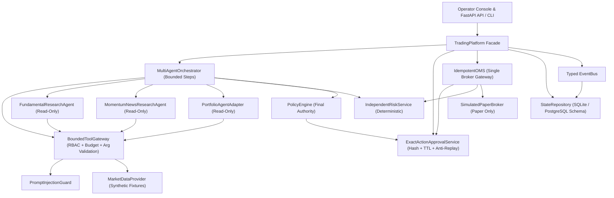
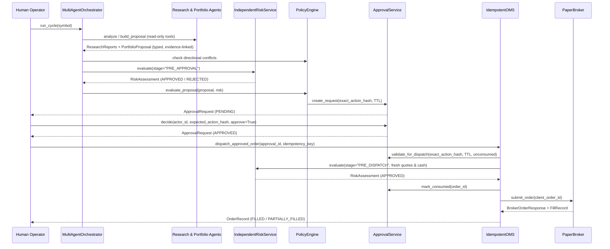

# Architecture & Component Boundaries

## 1. Design Principles

1. **Agents propose; deterministic code decides and executes.** Research and portfolio agents only hold read-only tool scopes (`get_quote`, `get_fundamentals`, `get_news`, `get_account_state`). They receive no reference to the OMS or broker and are structurally prevented from submitting or approving orders.
2. **Untrusted external data is quarantined.** External news and filings pass through `PromptInjectionGuard` before agent consumption; tainted items are tagged in `EvidenceItem`, excluded from sentiment scoring, and audited.
3. **Two-stage independent risk validation.** `IndependentRiskService` evaluates every proposal at `PRE_APPROVAL` and repeats the full validation suite at `PRE_DISPATCH` immediately before broker submission using fresh quotes and current persisted account balances.
4. **Exact-action, expiring, single-use approvals.** Approvals bind a canonical SHA-256 `exact_action_hash` over every executable parameter (`account_id`, `symbol`, `side`, `quantity`, `order_type`, `limit_price`, `time_in_force`, `currency`, `policy_version`, `proposal_id`), expire after `approval_ttl_seconds`, and transition to `CONSUMED` upon first dispatch.
5. **Idempotency & auditability by default.** Every dispatch requires an `idempotency_key`, every broker fill is deduplicated by `broker_fill_id`, and every state transition or denial is appended to a SHA-256 hash-chained `audit_log`.

## 2. System Architecture Diagram

## 3. Proposal-to-Execution Sequence

## 4. Component Boundary Matrix

| Component | Package Path | Allowed Side Effects | Explicit Prohibitions |
|---|---|---|---|
| Domain Contracts & Config | `src/trading_platform/domain/` | None (pure models & hashes) | No I/O, no live mode allowed |
| Storage & Event Bus | `src/trading_platform/storage/` | Persist state, events, append-only audit | No mutation/deletion of audit rows |
| Tool Gateway & Market Tools | `src/trading_platform/tools/` | Read fixtures, persist evidence & tool logs | Blocks all execution/admin tool names |
| Research & Portfolio Agents | `src/trading_platform/agents/` | Call read-only tools via `BoundedToolGateway` | No broker/OMS reference; cannot approve/execute |
| Independent Risk Service | `src/trading_platform/agents/risk_agent.py` | Pure deterministic limit & staleness checks | No agent influence; no order submission |
| Policy & Approval Services | `src/trading_platform/policy/` | Persist approval state & audit decisions | Rejects agent/auditor/admin approvers and `LIVE` mode |
| OMS & Paper Broker | `src/trading_platform/execution/` | Persist orders/fills, update paper ledger | Rejects dispatch if mode != `PAPER` or kill switch ON |
| FastAPI / Operator Console / CLI | `src/trading_platform/api/`, `web/`, `cli.py` | Operator workflow & observability | Cannot bypass approvals or pre-dispatch risk |
