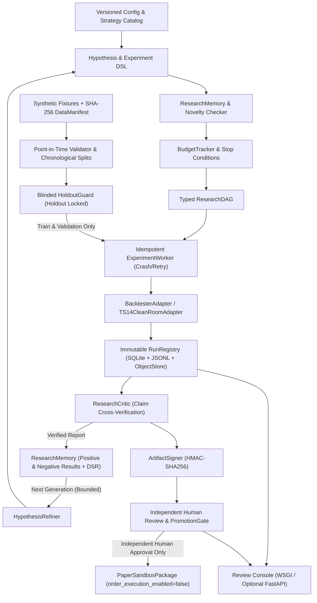

# Architecture — Recursive AI Research Platform (RARP)

## System Overview

RARP implements a bounded, auditable recursive research loop with strict separation between hypothesis generation, deterministic execution, immutable provenance storage, claim verification, and independent human review.

## Component Boundaries

| Component | Module | Responsibility & Boundary |
|---|---|---|
| **Domain & DSL** | `src/rarp/domain/` | Owns canonical schemas (`HypothesisSpec`, `ExperimentSpec`, `DataManifest`, `BudgetSpec`, `CostModelSpec`), enforces catalog bounds, bans arbitrary generated code, enforces causal lag `>= 1`, and defines structured errors. |
| **Data & Blinded Holdout** | `src/rarp/data/` | Generates deterministic synthetic fixtures with SHA-256 manifests, validates `available_time_utc <= event_time_utc` and manifest integrity, builds embargoed chronological splits, and isolates holdout behind single-use independent reviewer tokens. |
| **DAG, Budget & Workers** | `src/rarp/scheduler/` | Maintains acyclic research lineage, guarantees atomic budget enforcement prior to dispatch, runs causal cost-aware evaluations behind `BacktesterAdapter` / `TS14BacktesterAdapter`, and provides idempotent crash/retry execution. |
| **Immutable Registry & Memory** | `src/rarp/registry/` | Persists append-only runs, critic reports, review decisions, and audit events with SQLite `BEFORE UPDATE`/`BEFORE DELETE` immutability triggers and SHA-256 hash-chaining. Tracks negative results, novelty distances, and PSR/DSR/Bonferroni multiple-testing penalties. |
| **Evidence-Linked Critic & Refiner** | `src/rarp/critic/` | Independently verifies every `MetricClaim` against the immutable registry before accepting a report, quarantines hallucinated metrics, and proposes bounded novel refinements. |
| **Governance & Review Console** | `src/rarp/governance/` | Signs research artifacts with HMAC-SHA256, enforces independent human approval (`reviewer_id != proposer_id`), prohibits `LIVE` promotion, emits paper-sandbox-only packages with `order_execution_enabled=false`, and serves the review console. |

## Process & Storage Boundaries

- **MVP deployment:** Single local deterministic process backed by SQLite (`registry.db`), append-only `audit_log.jsonl`, and content-addressed local filesystem object store (`objects/`).
- **Scale-out seams:** `ObjectStore`, `BacktesterAdapter`, `CriticAdapter`, `RefinerAdapter`, and `create_fastapi_app()` isolate external provider interfaces (PostgreSQL, S3/GCS, FastAPI, optional LLM APIs) from core domain invariants.
