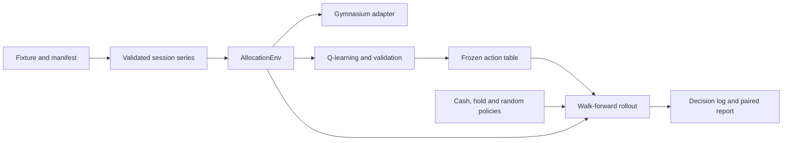

# Simulator design and contracts

## Architecture and decisions

The bounded task is allocation between one synthetic instrument and USD cash. Daily decisions, fractional shares and a 45-state table keep the policy and its training budget inspectable on a laptop. All four policies share the same ledger. A deterministic simulator runs in one process and has no network interface. The only optional runtime components are NumPy and Gymnasium at the adapter boundary.

No reviewed shared simulator or backtester interface was supplied. The adapter contract is an immutable sequence of validated bars. A future reviewed data adapter can construct those bars directly. The synthetic CSV loader separately enforces the fixture manifest. Actual SAAT instruments, horizon, provider entitlements and ownership terms remain open for a future integration.

## Data, observations and actions

`data/fixtures/manifest.json` identifies the asset, currency, schema, generator, seed, row count and SHA-256 of the input bytes. Each CSV row has a UTC opening time, closing time and closing-data availability time. Version one requires availability at the decision close. Opening and closing USD prices are positive and finite. Opening auction volume is nonnegative and measured in shares. Sessions are strictly ordered and disjoint. The generator uses fictional weekdays, fixed UTC hours and alternating drifts.

At close *t*, the three integer observations are the one-session close return bucket, five-session cumulative close return bucket and current exposure bucket. For each return the bucket is 0 below −0.2%, 2 above +0.2% and 1 otherwise. Early lags use the earliest available close. Exposure is four times marked risky value divided by total equity, rounded to the nearest integer (ties to even). Thus the Gym space is MultiDiscrete([3, 3, 5]). Regime labels, future auction prices, volume and timestamps are excluded from policy inputs.

Actions 0, 1 and 2 request 0%, 50% and 100% invested respectively. Each action specifies a target fraction for the next auction, whose price determines quantity. Cash and holdings start at USD 10,000 and zero shares by default. There is no borrowing or short selling. Cash earns zero interest. The cash baseline always requests zero. Buy-and-hold requests 100% until filled and then carries the position. Random allocation draws uniformly from all three actions.

## Accounting and risk

Existing holdings earn the overnight gap. At the next open, buys pay the opening reference price plus slippage, and sells receive the opening price less slippage. Fees apply to executed notional at that fill price. Default fees are 2 basis points and adverse slippage is 5 basis points on each side. Let P be the open, V pretrade equity at the open, H the marked holding, w the target weight and c per-share slippage plus commission. Requested unsigned shares equal |wV − H| / (P + sign(wV − H) × w × c). The fill is capped by cash or inventory and 5% of the published opening auction shares. Unfilled shares expire. Orders have no influence on the synthetic price path.

A transition ends at the next close. Equity is cash plus shares times the closing price. Reward is log(final equity / prior equity), so cumulative rewards reconcile to the terminal marked equity. Positions are valued at the final close with no forced liquidation. A terminal step sets `terminated=True`, `truncated=False`. Calling step again requires reset. The fill record carries both decision and fill time, requested and executed quantity, fill price, fee, slippage, cash, shares and marked equity. `notional` is absolute shares times the opening reference price for turnover measurement. Invalid actions fail before mutation. Contract errors expose a machine-readable `code`.

## Selection, evaluation and policy format

Start with 120 training transitions and expand by 40 per fold. Train two zero-initialized Q-tables for 20 complete episodes each. The candidates share the same per-fold random seed, epsilon of 0.2 and discount of 0.95. Learning rates are 0.08 and 0.25. Each update targets reward plus discounted best next Q, with zero bootstrap at termination. Greedy ties use the lowest action. Select by highest net return on the next 40 validation transitions, using configuration order for ties. Evaluate the frozen winner on the following 40 transitions. Later folds can use earlier realized history. Consecutive windows share a boundary observation and have disjoint test returns. Accounts reset at each window. Pre-window closes supply causal feature history. Partial trailing folds are excluded.

Base evaluation, doubled fees and slippage, and a falling market with thin auctions each run every policy. The selloff stresses only held-out bars. On its nth session the original open is scaled by 0.92 × 0.997^(n−1), the close by a further 0.997, and auction liquidity by 0.25. Random policies reuse their fold seed on each scenario. Reported metrics include net marked return, maximum peak-to-trough drawdown from starting equity, population standard deviation of daily log returns, cumulative one-way turnover, costs in USD and partial fill count. Interval estimates use the 2.5th and 97.5th percentile bounds from 1,000 deterministic bootstrap draws of whole folds. Excess returns use paired fold differences. The small number of dependent windows and single synthetic history limit inference.

`paper-policy.json` contains the last fold’s validation winner. The versioned action array enumerates (one-day bucket, five-day bucket, exposure bucket) in ascending lexicographic order. Load it with `trading_engine.policy.load_policy(json_payload)` and select an integer action by indexing the returned mapping with the observed tuple. Loading validates mode, schema, instrument, state encoding, targets and every action. All per-fold exports carry the training/validation boundaries and hashes. The host accepts simulation actions only.

Unsupported features include live routing, paper broker connectivity, real market data, multi-asset portfolios, leverage, settlement, dividends, interest, intraday queue dynamics, exchange calendars and transaction impact beyond the fixed slippage and capacity rules.
