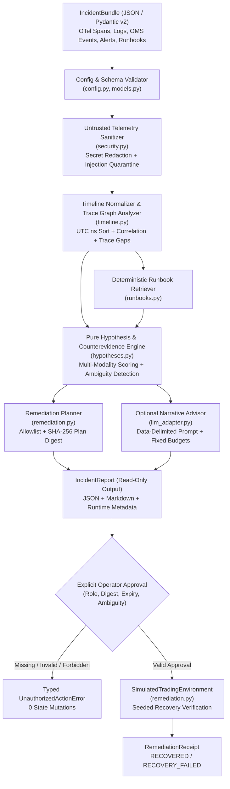

# Architecture — Trading Incident Investigation Agent

## 1. System Overview

The Trading Incident Investigation Agent reconstructs simulated trading incidents from heterogeneous telemetry (OpenTelemetry spans, structured logs, OMS events, and alerts), retrieves relevant runbooks, evaluates competing root-cause hypotheses with counterevidence, and proposes bounded simulated remediations gated by explicit operator approval.

All core reasoning, scoring, policy checks, and verification are **deterministic and isolated from I/O and LLM calls**. By default, the agent runs in **strictly read-only mode** (`read_only_enforced=True`, `operational_changes_applied=0`).

## 2. Component Diagram

## 3. Data Flow and Security Boundaries

1. **Strict Ingestion Boundary (`config.py`, `models.py`)**:
   - Rejects unsupported `schema_version` values, non-UTC/naive timestamps, negative durations/latencies, empty telemetry bundles, and any `environment` outside `{"synthetic", "paper", "sim"}`.
   - Computes canonical SHA-256 `input_digest` and `config_digest` for deterministic reproducibility and stable `report_id` generation.
2. **Untrusted-Text Sanitization Boundary (`security.py`)**:
   - Every free-text telemetry field and string attribute is treated as untrusted data.
   - Secret patterns (Bearer tokens, `api_key=...`, `password=...`, AWS-style keys) are redacted **first** before any downstream logging or reporting.
   - Adversarial prompt-injection directives (`ignore previous instructions`, `system override`, `auto_approve=true`, `cancel_all_orders`, `disable_risk_limits`) are quarantined into `[QUARANTINED_UNTRUSTED_DIRECTIVE]` while preserving surrounding technical telemetry.
3. **Timeline Normalization & Trace Graph Analysis (`timeline.py`)**:
   - Converts all timestamps into exact integer UTC nanoseconds (`timestamp_ns`) to avoid floating-point rounding drift.
   - Applies deterministic tie-breaking `(timestamp_ns, source_priority, source_id)` and assigns stable `evidence_id`s (`EV-0001-<source_id>`).
   - Inspects OpenTelemetry parent-child relationships to flag `missing_parent_span` gaps and `clock_skew` anomalies.
4. **Domain Reasoning Isolation (`runbooks.py`, `hypotheses.py`)**:
   - Runbook matching scores alert rules, OMS reject codes, service names, and symptom phrases deterministically without treating runbook prose as executable code.
   - Hypothesis evaluation weights independent modalities (`ALERT`, `OMS_EVENT`, `OTEL_SPAN`, `LOG`), down-weights uncorroborated log-only claims (`log_only_weight_multiplier=0.35`, confidence cap `0.30`), extracts explicit counterevidence (healthy OK spans on the hypothesized service, archival/unaffected channel logs, uncorrelated late-onset logs), penalizes confidence when trace gaps reduce visibility, and marks verdicts `AMBIGUOUS` when top-2 hypotheses fall within `ambiguity_margin` (`0.12`).
5. **Isolated Optional LLM Adapter (`llm_adapter.py`)**:
   - Wraps telemetry excerpts inside `<UNTRUSTED_TELEMETRY_EXCERPTS>...</UNTRUSTED_TELEMETRY_EXCERPTS>` after sanitization and enforces `max_llm_calls` and `max_prompt_chars` budgets.
   - The advisor may only return narrative prose; it has zero write access to verdicts, confidence scores, citations, or remediation proposals.
6. **Approval-Gated Simulated Remediation (`remediation.py`)**:
   - Proposals draw strictly from `ALLOWLISTED_SIM_ACTIONS`; `FORBIDDEN_ACTIONS` (e.g., `cancel_all_orders`, `disable_risk_limits`, `submit_live_order`) are unconditionally rejected even if supplied with an approval object.
   - Operator approvals are cryptographically bound via `plan_digest` (SHA-256 over incident, remediation ID, action ID, target service, and parameters), validated against `allowed_approver_roles`, expiration timestamps, and an ambiguity gate (`acknowledge_ambiguity=True` required if verdict is `AMBIGUOUS`).
   - Post-remediation verification runs deterministic, seeded checks on simulated metrics and recommends rollback if any threshold fails.

## 4. Core Invariants

- **Read-only by default:** `TradingIncidentAgent.investigate()` never invokes `SimulatedTradingEnvironment` and always returns `read_only_enforced=True` and `operational_changes_applied=0`.
- **Untrusted telemetry cannot escalate privileges:** Prompt injections in logs or span attributes cannot create proposals, bypass approval checks, or override deterministic root-cause scoring.
- **Explicit uncertainty:** Trace gaps, counterevidence, single-modality caps, and ambiguous top-2 margins are always surfaced in `uncertainty_notes` and `HypothesisEvaluation.uncertainty_factors`.
- **Reproducibility:** Identical inputs, config, and seed produce byte-identical `IncidentReport` JSON payloads and `report_id`s.

## 5. Key Trade-Offs

- **Rule/evidence-weighted hypothesis scoring vs. LLM-only diagnosis:** Deterministic multi-modality scoring trades open-ended linguistic flexibility for auditability, repeatable unit tests, resistance to prompt injection, and calibrated uncertainty bounds. An optional LLM callback can still polish executive summaries without compromising policy integrity.
- **Static allowlist of simulated remediations vs. dynamic command synthesis:** Restricting actions to a curated allowlist prevents arbitrary command execution from runbook prose or poisoned logs, at the cost of requiring explicit engineering review to register new simulated actions.
